# Ludexora: A Comprehensive System Overview

### Sri Lankan Legal Document Management and Publishing Platform

---

**Document Type:** Thesis-Level System Documentation  
**Project Name:** Ludexora (Legal Admin)  
**Framework:** Laravel 12 · PHP 8.2 · MySQL  
**Document Version:** 1.0  
**Date:** June 2026

---

## Table of Contents

1. [Executive Summary](#1-executive-summary)
2. [System Overview](#2-system-overview)
3. [Software Architecture](#3-software-architecture)
4. [System Components](#4-system-components)
5. [Module Analysis](#5-module-analysis)
6. [Database Design](#6-database-design)
7. [API Design](#7-api-design)
8. [Authentication and Authorization](#8-authentication-and-authorization)
9. [Frontend Architecture](#9-frontend-architecture)
10. [Backend Architecture](#10-backend-architecture)
11. [External Integrations](#11-external-integrations)
12. [Infrastructure and Deployment](#12-infrastructure-and-deployment)
13. [Data Flow Analysis](#13-data-flow-analysis)
14. [Design Patterns](#14-design-patterns)
15. [Non-Functional Requirements](#15-non-functional-requirements)
16. [Technology Stack](#16-technology-stack)
17. [System Workflow](#17-system-workflow)
18. [Thesis Documentation Section](#18-thesis-documentation-section)
19. [Code Metrics](#19-code-metrics)
20. [Conclusion](#20-conclusion)

---

## 1. Executive Summary

### 1.1 Purpose of the System

Ludexora is a web-based legal document management and publishing platform designed to digitise, structure, and disseminate Sri Lankan legislative instruments. The system provides a complete lifecycle management solution for Acts of Parliament, beginning with their official publication in government gazettes, through to hierarchical section management, cross-referencing between clauses, importation of case law precedents, and public dissemination via a standards-compliant REST API.

The system was developed to address the absence of a machine-readable, structured repository of Sri Lankan legislation — a gap that hinders both legal research and the development of AI-powered legal tools. By providing a dual-tier API (a full-featured internal API for administrative workflows and a read-only public API for external consumers), Ludexora enables third-party applications — including AI-powered legal assistants — to access authoritative legislative data without reimplementing data collection.

*Source files: `docs/PUBLIC_API.md`, `docs/CODEX_PROMPT.md`, `app/Http/Controllers/Admin/DashboardController.php`*

### 1.2 Main Business Problem Solved

Sri Lankan legislation exists in two principal forms: (1) official PDF gazettes published by the Government Printing Department, and (2) fragmented online sources of varying accuracy. Neither form is structured for programmatic consumption. Legal professionals, technology companies building legal-tech products, and researchers working with Sri Lankan law face the following challenges:

- **Lack of machine-readable structure:** PDFs do not expose the hierarchical relationship between Parts, Chapters, Sections, and Subsections.
- **No cross-reference linkage:** References between sections ("subject to the provisions of Section 73(1)") are textual strings rather than navigable hyperlinks.
- **No versioning or amendment tracking:** When an Act is amended, there is no authoritative record of which sections were replaced and by what.
- **Inaccessibility to AI systems:** Large language models and legal AI assistants require clean, structured text with provenance metadata; raw PDFs cannot reliably provide this.

Ludexora solves all four problems through a structured data model, an AI-assisted import pipeline, explicit version-tracking relationships, and a public REST API.

*Source files: `app/Services/LegalDocumentParser.php`, `database/migrations/2026_06_09_000300_create_legal_nodes_table.php`, `app/Http/Controllers/Admin/ImportController.php`*

### 1.3 Key Features

| Feature | Description | Source |
|---|---|---|
| Gazette Management | Create and track official government gazette publications | `app/Models/Gazette.php` |
| Act Management | CRUD for Acts with status tracking (active/repealed/amended) and replacement lineage | `app/Models/Act.php` |
| Hierarchical Section Tree | 10-type legal node system (PART → CHAPTER → SECTION → SUBSECTION → PARAGRAPH → SUBPARAGRAPH → ITEM → SCHEDULE → PREAMBLE → DEFINITIONS) | `database/migrations/2026_06_09_000300_create_legal_nodes_table.php` |
| Cross-Reference Graph | Directed typed edges between sections (refers_to, subject_to, as_amended_by, repeals, saves, cross_applies) | `app/Models/CrossReference.php` |
| Node Versioning | Sections track replaced_by/replaces relationships enabling amendment history | `app/Models/LegalNode.php` |
| AI-Powered Import | Upload a gazette PDF; an AI agent (Claude API) parses it into the structured JSON schema; the service layer imports it | `app/Http/Controllers/Admin/ImportController.php` |
| Case Law Repository | Storage and retrieval of judicial precedents for cross-referencing with legislation | `app/Models/CaseLaw.php` |
| Full-Text Search | MySQL FULLTEXT index on node content and headings | `app/Http/Controllers/Admin/SearchController.php` |
| Public REST API | Unauthenticated read-only API for external consumers | `routes/api.php`, `app/Http/Controllers/Api/Public*` |
| Chat/AI Session Support | Data model for AI assistant conversations with cited section references | `app/Models/ChatSession.php`, `app/Models/ChatMessage.php` |
| Role-Based Access Control | Admin-only write operations; public API unrestricted read | `app/Http/Middleware/EnsureAdmin.php` |

### 1.4 Intended Users

The system serves three distinct user categories:

1. **Legal Administrators (Admin Panel Users):** Legal researchers, government officials, or legal-tech company employees who import, curate, and maintain the legislative database. They interact via the web-based admin panel. Access is restricted by the `EnsureAdmin` middleware and requires explicit `is_admin` flag assignment.

2. **Public API Consumers:** External developers or organisations who integrate with the public API (`/api/public/v1/`) to build legal reference products, AI systems, or research tools. No authentication is required. Access is read-only.

3. **AI Agent Consumers:** Automated systems (AI assistants, retrieval-augmented generation pipelines) that use the internal API (`/api/v1/`) endpoints specifically designed to provide full law context — including ancestor sections, cross-referenced laws, and leaf-node enumeration — to feed AI inference engines. *Source: `app/Http/Controllers/Api/LegalNodeApiController.php`, methods `lawContext()` and `lawPath()`.*

---

## 2. System Overview

### 2.1 High-Level Description

Ludexora is a monolithic web application built on the Laravel 12 framework, following the Model-View-Controller (MVC) architectural pattern. It is deployed as a single PHP application served by a web server (Apache or Nginx) backed by a MySQL relational database. The system exposes two interfaces: a server-rendered HTML admin panel accessed via web browser, and a JSON REST API accessed programmatically.

### 2.2 Core Functionalities

1. **Legislation Ingestion:** Import Acts of Parliament either manually through CRUD forms or automatically by uploading a PDF gazette and invoking the AI-powered import pipeline, which calls the Anthropic Claude API to extract structured content.

2. **Hierarchical Content Management:** Manage the nested tree structure of legal documents. Each Act is decomposed into a tree of `LegalNode` entities with explicit parent-child relationships, enforced ordering (`sort_order`), computed depth (`level`), and a denormalised `has_children` flag for efficient rendering.

3. **Cross-Reference Management:** Create and browse typed directed edges (CrossReferences) between any two LegalNode entities, enabling navigation of the inter-section citation graph.

4. **Case Law Management:** Store and query judicial case law records, linked to the legislative corpus.

5. **Public Data Dissemination:** Expose all legislation data through an authenticated-free public REST API suitable for embedding in external websites, legal databases, and AI systems.

6. **User Administration:** Manage the user accounts that are permitted to use the admin panel.

### 2.3 System Boundaries

**In Scope:**
- All legislative data originating from Sri Lankan government gazettes
- Administrative tools for maintaining that data
- REST API for read access to that data
- AI-assisted import workflow (PDF → JSON → database)

**Out of Scope:**
- The AI assistant front-end (chat interface is modelled in the database but no UI is implemented)
- Electronic filing of new legislation by government agencies
- Legal case management or litigation tracking
- Payment processing or e-commerce

### 2.4 Major Subsystems

| Subsystem | Role |
|---|---|
| Admin Panel | Server-side rendered HTML interface for all write operations |
| Authentication Subsystem | Session-based login with admin role gating |
| Gazette & Act Management | CRUD operations for top-level legislative containers |
| Legal Node Subsystem | Hierarchical section tree management with versioning |
| Cross-Reference Subsystem | Graph of inter-section relationships |
| Case Law Subsystem | Judicial precedent repository |
| Import Subsystem | AI-assisted PDF-to-database pipeline |
| Internal API | JSON endpoints for admin panel AJAX and AI agent consumption |
| Public API | Unauthenticated JSON endpoints for external consumers |
| Search Subsystem | Full-text search across all legal content |
| Chat Data Model | Storage infrastructure for AI conversation sessions |

---

## 3. Software Architecture

### 3.1 Architectural Style

Ludexora employs a **Monolithic Layered Architecture** with clear separation of concerns across the following layers:

| Layer | Technologies | Responsibility |
|---|---|---|
| Presentation | Blade Templates, Tailwind CSS v4, Axios | Rendering UI, handling browser interactions |
| Routing | Laravel Router (`routes/web.php`, `routes/api.php`) | URL dispatch to controller methods |
| Controller | PHP Controller Classes | Request handling, orchestration, response formatting |
| Request Validation | Laravel FormRequest classes | Input validation and authorisation pre-checks |
| Service | `LegalDocumentParser` Service | Complex business logic, transactions |
| Domain Model | Eloquent ORM Models | Business rules, relationships, scopes |
| Data Access | Laravel Eloquent ORM | Database query generation |
| Data Serialisation | Laravel API Resources | Transforming models to JSON responses |
| Persistence | MySQL via PDO | Storage and retrieval of all data |

The system additionally exposes a **REST API tier** that follows the resource-oriented architecture style, distinguishing between internal (authenticated) and public (unauthenticated) API namespaces.

### 3.2 Architecture Rationale

The choice of monolithic architecture is deliberate and appropriate for this stage of the system:

1. **Domain cohesion:** All data — gazettes, acts, nodes, references, case laws, users — is tightly coupled in a relational schema. Decomposing this into microservices would introduce distributed transaction complexity with no proportionate benefit given the current scale.

2. **Deployment simplicity:** A single PHP application can be deployed on a standard shared hosting environment or a single VPS, which aligns with the resource constraints of a Sri Lankan legal institution.

3. **Laravel's proven strength:** Laravel 12's built-in MVC conventions, Eloquent ORM, form request validation, API resources, and middleware system allow rapid, correct implementation without reinventing infrastructure.

4. **Future API-first extensibility:** The dual-tier API design (internal v1 + public v1) ensures that even within the monolith, data access is properly abstracted. The system can be decoupled into separate services in the future without changing the API contracts.

*Source: `bootstrap/app.php`, `routes/web.php`, `routes/api.php`*

### 3.3 Component Interactions

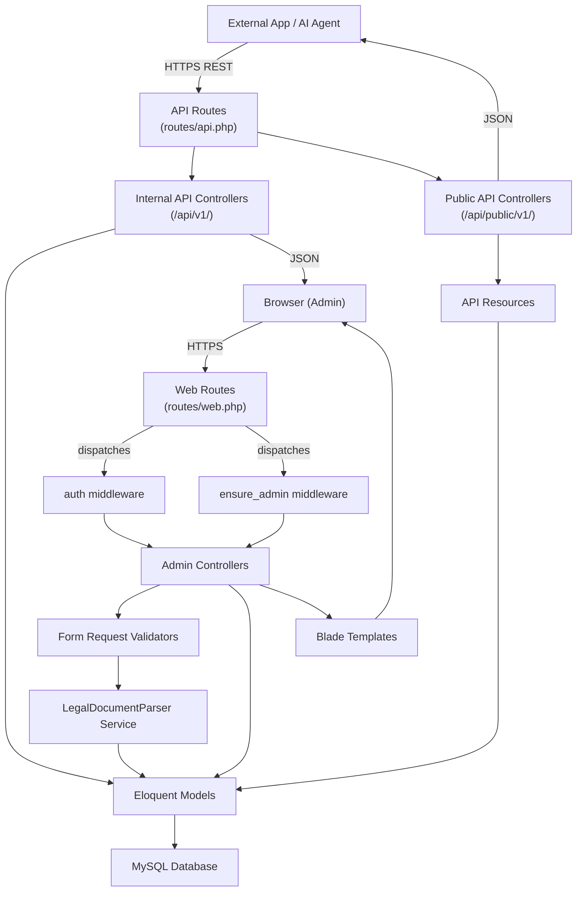

### 3.4 Data Flow Explanation

A typical administrative write operation follows this path:

1. **Browser** submits an HTML form (e.g., create a new LegalNode).
2. **Laravel Router** matches the URL to `LegalNodeController::store()` after passing through `auth` and `ensure_admin` middleware.
3. **StoreLegalNodeRequest** validates all input fields; invalid requests are rejected with a 422 response before the controller executes.
4. **LegalNodeController** calls `DB::transaction()`, creates the `LegalNode` Eloquent model, and updates the parent's `has_children` flag.
5. **Eloquent ORM** generates and executes the `INSERT` SQL statement via PDO.
6. **MySQL** persists the record and returns the new primary key.
7. **Controller** redirects the browser to the node's detail view with a flash success message.

A public API read operation follows a simpler path:

1. **External client** sends `GET /api/public/v1/acts/{act}/tree`.
2. **Laravel Router** dispatches to `PublicActController::tree()` with no middleware.
3. **Controller** calls `LegalDocumentParser::buildTreeJson()`.
4. **Service** issues recursive Eloquent queries to build the nested structure.
5. **Controller** returns a `JsonResponse` directly (no Resource class for tree endpoints).

---

## 4. System Components

### 4.1 Admin Panel (Web Interface)

| Attribute | Value |
|---|---|
| **Name** | Admin Panel |
| **Purpose** | Provide administrators with a complete UI to create, read, update, and delete all legislative entities |
| **Responsibilities** | Render server-side HTML, handle form submissions, display search results, show dashboard statistics, manage users |
| **Inputs** | HTTP GET/POST/PUT/DELETE requests from authenticated admin browsers |
| **Outputs** | Rendered Blade HTML responses, JSON fragments for AJAX sub-requests |
| **Dependencies** | Admin Controllers, Blade Templates, Eloquent Models, Form Request Validators |
| **Technologies** | PHP 8.2, Laravel Blade, Tailwind CSS v4, Vanilla JavaScript, Axios |

*Source: `resources/views/admin/`, `app/Http/Controllers/Admin/`*

### 4.2 Authentication Component

| Attribute | Value |
|---|---|
| **Name** | Authentication Component |
| **Purpose** | Verify user identity and enforce role-based access control |
| **Responsibilities** | Session creation on login, session destruction on logout, admin role verification on every admin request |
| **Inputs** | Email/password credentials submitted via login form |
| **Outputs** | Authenticated session token stored server-side (database-backed sessions), redirect to admin dashboard or error |
| **Dependencies** | `User` model, `sessions` table, `EnsureAdmin` middleware |
| **Technologies** | Laravel Auth facade, database sessions, bcrypt password hashing |

*Source: `app/Http/Controllers/Auth/LoginController.php`, `app/Http/Middleware/EnsureAdmin.php`*

### 4.3 Legal Document Parser Service

| Attribute | Value |
|---|---|
| **Name** | LegalDocumentParser Service |
| **Purpose** | Encapsulate all complex, multi-step business logic for importing and building legal document trees |
| **Responsibilities** | Parse structured JSON into database records; recursively insert node trees; resolve cross-reference paths; build nested tree structures for API responses |
| **Inputs** | Structured JSON array representing a gazette, act, node tree, and cross-reference list |
| **Outputs** | Persisted `Act` object (with full tree in database); nested PHP array for tree endpoints |
| **Dependencies** | `Gazette`, `Act`, `LegalNode`, `CrossReference` Eloquent models; MySQL `DB` facade |
| **Technologies** | PHP 8.2, Laravel Eloquent, `DB::transaction()` |

*Source: `app/Services/LegalDocumentParser.php`*

### 4.4 Public API Component

| Attribute | Value |
|---|---|
| **Name** | Public REST API |
| **Purpose** | Provide unauthenticated, read-only access to all legislative data for external consumers |
| **Responsibilities** | Expose paginated Acts/Gazettes lists; return node detail, children, references; serve full-text search results |
| **Inputs** | HTTP GET requests with optional query parameters (pagination, search term) |
| **Outputs** | JSON responses serialised via API Resource classes or direct arrays |
| **Dependencies** | `PublicActController`, `PublicGazetteController`, `PublicLegalNodeController`, `PublicSearchController`, API Resource classes |
| **Technologies** | PHP 8.2, Laravel API Resources, MySQL FULLTEXT |

*Source: `app/Http/Controllers/Api/Public*.php`, `app/Http/Resources/`*

### 4.5 Internal API Component

| Attribute | Value |
|---|---|
| **Name** | Internal REST API (v1) |
| **Purpose** | Provide structured JSON endpoints for admin panel AJAX operations and AI agent data access |
| **Responsibilities** | Return act trees, leaf node lists, law context (full text + ancestors + referenced laws), update node content, manage cross-references, return case law |
| **Inputs** | HTTP GET/POST/PUT/DELETE from admin panel JavaScript or AI agent HTTP clients |
| **Outputs** | JSON responses; node trees; law context packages |
| **Dependencies** | `LegalNodeApiController`, `ActApiController`, `CrossReferenceApiController`, `CaseLawApiController`, Eloquent models |
| **Technologies** | PHP 8.2, Laravel Eloquent, JSON serialisation |

*Source: `app/Http/Controllers/Api/ActApiController.php`, `app/Http/Controllers/Api/LegalNodeApiController.php`*

### 4.6 Import Component

| Attribute | Value |
|---|---|
| **Name** | Import Component |
| **Purpose** | Allow administrators to import new Acts from gazette PDFs by leveraging AI parsing |
| **Responsibilities** | Accept PDF file upload; forward to Anthropic Claude API for structured extraction; preview parsed JSON; call LegalDocumentParser to persist data |
| **Inputs** | PDF file upload via multipart form; JSON data for confirmation step |
| **Outputs** | Preview of parsed JSON; persisted Act record in database |
| **Dependencies** | `ImportController`, `LegalDocumentParser` service, Anthropic Claude API (HTTP client) |
| **Technologies** | PHP 8.2, Laravel HTTP client, Anthropic Claude API |

*Source: `app/Http/Controllers/Admin/ImportController.php`*

### 4.7 Search Component

| Attribute | Value |
|---|---|
| **Name** | Search Component |
| **Purpose** | Provide full-text search across all legal node content and headings |
| **Responsibilities** | Accept search query; execute MySQL FULLTEXT `MATCH ... AGAINST` query; return results with contextual snippets; enforce result limit |
| **Inputs** | Query string `q` (minimum 3 characters) |
| **Outputs** | Array of matching LegalNode records with snippet previews |
| **Dependencies** | `SearchController`, `PublicSearchController`, `LegalNode` model with FULLTEXT index |
| **Technologies** | MySQL FULLTEXT index on `(text_content, heading)` |

*Source: `app/Http/Controllers/Admin/SearchController.php`, `app/Http/Controllers/Api/PublicSearchController.php`*

---

## 5. Module Analysis

### 5.1 `app/Models/` — Domain Models

**Functionality:** Define the core business entities, their relationships, validation scopes, and computed properties. All models extend `Illuminate\Database\Eloquent\Model` and leverage Eloquent's feature set.

**Key Classes:**

| Class | Key Relationships | Notable Features |
|---|---|---|
| `User` | `hasMany(ChatSession)` | `is_admin` boolean; password auto-hashed via cast |
| `Gazette` | `hasMany(Act)` | `gazette_date` cast to Carbon date; `active()` scope |
| `Act` | `belongsTo(Gazette)`, `hasMany(LegalNode)`, self-referential replacement links | `commencement_date` cast; `active()`, `repealed()` scopes |
| `LegalNode` | `belongsTo(Act)`, `belongsTo(self)` as parent, `hasMany(self)` as children, self-referential replacement, `hasMany(CrossReference)` both directions | Soft deletes (`SoftDeletes` trait); FULLTEXT index; `getFullPath()` method; `has_children` denormalised flag |
| `CrossReference` | `belongsTo(LegalNode)` as source and target | Unique constraint on `(source_node_id, target_node_id)`; `ofType()` scope |
| `CaseLaw` | — | `active()`, `overruled()` scopes |
| `ChatSession` | `belongsTo(User)`, `hasMany(ChatMessage)` | `last_message_at` timestamp for recency ordering |
| `ChatMessage` | `belongsTo(ChatSession)` | `role` enum; `cited_section_ids` JSON cast for array of referenced node IDs |

**Relationships with Other Modules:** Models are consumed by all Controller classes. API Resources wrap models for serialisation. The LegalDocumentParser Service directly instantiates models via `::create()` and `::firstOrCreate()`.

*Source: `app/Models/*.php`*

### 5.2 `app/Http/Controllers/Admin/` — Admin Controllers

**Functionality:** Handle all web requests from the admin panel. Each controller corresponds to a primary resource or screen.

**Key Controllers and Important Functions:**

| Controller | Important Functions |
|---|---|
| `DashboardController::index()` | Aggregates counts via `::count()` on all major tables; groups acts by status and nodes by type; queries recent acts |
| `LegalNodeController::newVersion()` | Creates a new `LegalNode` record cloned from existing, increments `version_no`, sets `replaces_node_id` back-link, marks old node as replaced |
| `LegalNodeController::store()` | Wraps creation in `DB::transaction()`; conditionally updates parent's `has_children` flag |
| `ImportController::processImport()` | Calls HTTP client to Anthropic Claude API with PDF content; returns parsed JSON for admin review |
| `ImportController::confirmImport()` | Accepts reviewed JSON; delegates to `LegalDocumentParser::importFromJson()` |
| `SearchController::search()` | Executes `MATCH(text_content, heading) AGAINST(? IN BOOLEAN MODE)` with snippet extraction using `SUBSTRING()` and `LOCATE()` |
| `StructureController::children()` | Returns JSON of immediate children for a given node (used by interactive tree browser) |
| `UserController::destroy()` | Prevents self-deletion via `auth()->id() !== $user->id` check |

*Source: `app/Http/Controllers/Admin/*.php`*

### 5.3 `app/Http/Controllers/Api/` — API Controllers

**Functionality:** Handle JSON API requests for both internal and public consumers.

**Key Functions:**

| Controller | Important Functions |
|---|---|
| `LegalNodeApiController::lawContext()` | Returns a node's full text, its ancestor chain (parent → grandparent → … → top), plus the full text of each cross-referenced law; designed specifically to provide AI agents the complete legal context needed to answer questions about a specific section |
| `LegalNodeApiController::lawPath()` | Returns the node plus all ancestor nodes in hierarchical order, enabling a "breadcrumb" view of where in the Act a section sits |
| `LegalNodeApiController::leafNodes()` | Returns all leaf nodes (nodes with `has_children = false`) across all acts; enables AI indexing pipelines to enumerate all atomic legal provisions |
| `ActApiController::tree()` | Delegates to `LegalDocumentParser::buildTreeJson()` for a fully nested act structure |
| `PublicSearchController::search()` | Validates minimum query length (3 chars); executes fulltext search; returns max 50 results with snippets |

*Source: `app/Http/Controllers/Api/*.php`*

### 5.4 `app/Services/` — Service Layer

**Functionality:** Encapsulate complex, multi-step business logic that does not belong in a controller.

**Key Service: `LegalDocumentParser`**

| Function | Purpose |
|---|---|
| `importFromJson(array $data)` | Full import transaction: creates/upserts Gazette, creates Act, recursively creates entire node tree via `insertNode()`, creates all cross-references via `insertCrossReferences()` |
| `buildTreeJson(int $actId)` | Fetches all non-deleted nodes for an act, recursively builds nested PHP array structure suitable for JSON serialisation |
| `insertNode()` (private) | Creates a single `LegalNode` record, then recursively calls itself for each child in the input array |
| `resolveNodeByPath()` (private) | Parses human-readable section paths like "73.(1)" into database node IDs by matching `node_no` values in the hierarchy |

*Source: `app/Services/LegalDocumentParser.php`*

### 5.5 `app/Http/Requests/` — Form Validation

**Functionality:** Decouple input validation from controller logic using Laravel's FormRequest pattern.

**Key Requests:**

| Request Class | Validates |
|---|---|
| `StoreGazetteRequest` | gazette_no, gazette_date, title, status enum |
| `StoreActRequest` | gazette_id (FK), act_no, act_year, title, status enum, replacement act IDs |
| `StoreLegalNodeRequest` | act_id (FK), parent_node_id (FK, nullable), node_type enum (10 valid types), level range (1–10), sort_order |
| `StoreCrossReferenceRequest` | source/target node IDs (must be different), reference_type enum (6 valid types) |
| `StoreCaseLawRequest` | case_name, content (required), status enum |

*Source: `app/Http/Requests/*.php`*

### 5.6 `app/Http/Resources/` — API Serialisation

**Functionality:** Transform Eloquent model instances into consistent JSON structures, decoupling the API response format from the database schema.

| Resource | JSON Fields Produced |
|---|---|
| `ActResource` | act_id, act_no, act_year, title, short_title, commencement_date (formatted), status, current_version, replaces_act_id, replaced_by_act_id, gazette (nested GazetteResource) |
| `GazetteResource` | gazette_id, gazette_no, gazette_date (formatted), title, status, acts (ActResource collection) |
| `LegalNodeResource` | node_id, act_id, parent_node_id, node_type, node_no, heading, marginal_note, text_content, level, sort_order, has_children, status, effective_date, repealed_date, full_path (computed) |

*Source: `app/Http/Resources/*.php`*

### 5.7 `database/migrations/` — Schema Evolution

**Functionality:** Provide a versioned, sequential history of all schema changes enabling reproducible database setup.

11 migrations covering: user infrastructure, caching, queue infrastructure, chat system, admin flag, gazettes, acts, legal nodes, cross-references, and case laws.

*Source: `database/migrations/*.php`*

### 5.8 `resources/views/` — Blade Templates

**Functionality:** Server-side HTML rendering using Laravel Blade templating engine. All admin UI pages inherit from `layouts/app.blade.php`.

**Master Layout features (`admin/layouts/app.blade.php`):**
- Responsive sidebar with Ludexora branding
- Collapsible navigation sections
- Slot-based content injection (`@yield('content')`)
- Flash message auto-dismiss system (4-second timeout via JavaScript)
- Global tooltip system via `data-tooltip` attributes
- Form CSRF token injection

*Source: `resources/views/*.blade.php`*

---

## 6. Database Design

### 6.1 Database Type

**MySQL** (production), configured via `config/database.php`. The system also supports SQLite for development/testing. The MySQL-specific feature used is the `FULLTEXT` index on `legal_nodes(text_content, heading)` for efficient full-text search.

*Source: `.env`, `config/database.php`, `database/migrations/2026_06_09_000300_create_legal_nodes_table.php`*

### 6.2 Entity Descriptions

| Entity | Description |
|---|---|
| `users` | System user accounts. The `is_admin` boolean flag gates access to the admin panel. |
| `gazettes` | Official Sri Lankan Government Gazette publications. Each gazette is identified by a number and date. |
| `acts` | Parliamentary Acts published within a gazette. Tracks status (active/repealed/amended) and replacement lineage through self-referential foreign keys. |
| `legal_nodes` | The atomic building blocks of legislative text. Forms an n-ary tree via self-referential `parent_node_id`. Supports 10 node types, soft deletion, versioning, and full-text indexing. |
| `cross_references` | Directed, typed edges in the inter-section citation graph. Unique per (source, target) pair. |
| `case_laws` | Judicial case law records with textual content and status. |
| `chat_sessions` | Conversation sessions for the AI assistant feature. |
| `chat_messages` | Individual turns within a chat session. Stores role (user/assistant/system), content, and JSON-encoded array of cited section IDs. |
| `cache` | Laravel's database-backed cache key-value store. |
| `jobs` / `failed_jobs` | Laravel queue job infrastructure for background processing. |
| `sessions` | Database-backed session storage for authenticated users. |

### 6.3 ER Diagram (Mermaid)

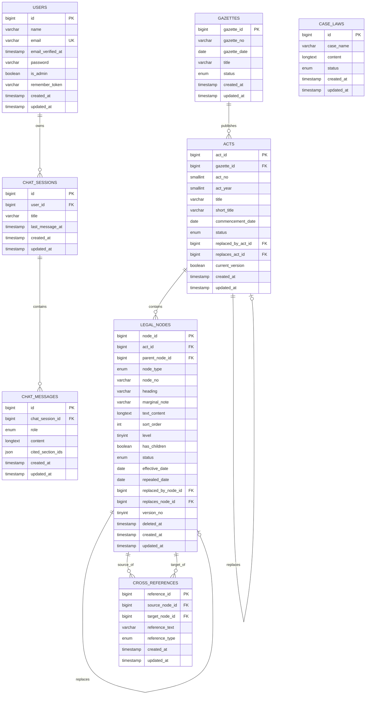

### 6.4 Tables and Relationships

| Table | Primary Key | Foreign Keys | Notable Indexes |
|---|---|---|---|
| `users` | `id` | — | UNIQUE `email` |
| `gazettes` | `gazette_id` | — | — |
| `acts` | `act_id` | `gazette_id → gazettes.gazette_id`, `replaced_by_act_id → acts.act_id`, `replaces_act_id → acts.act_id` | — |
| `legal_nodes` | `node_id` | `act_id → acts.act_id`, `parent_node_id → legal_nodes.node_id`, `replaced_by_node_id → legal_nodes.node_id`, `replaces_node_id → legal_nodes.node_id` | COMPOSITE `(act_id, parent_node_id, sort_order)`, `(act_id, node_type)`, FULLTEXT `(text_content, heading)` |
| `cross_references` | `reference_id` | `source_node_id → legal_nodes.node_id`, `target_node_id → legal_nodes.node_id` | UNIQUE `(source_node_id, target_node_id)` |
| `case_laws` | `id` | — | INDEX `(status)` |
| `chat_sessions` | `id` | `user_id → users.id` | INDEX `(last_message_at)` |
| `chat_messages` | `id` | `chat_session_id → chat_sessions.id` | INDEX `(role)` |

### 6.5 Database Schema Summary

The schema follows a **strictly normalised relational design** with the following design choices:

1. **Self-Referential Tree (Adjacency List Pattern):** `legal_nodes.parent_node_id` references `legal_nodes.node_id`. This is the simplest pattern for hierarchical data in relational databases and is appropriate given that Laravel does not have built-in support for more complex patterns (Nested Set, Closure Table). Tree traversal is handled in PHP via recursive function calls. *Source: `database/migrations/2026_06_09_000300_create_legal_nodes_table.php`*

2. **Denormalisation for Performance:** The `has_children` boolean on `legal_nodes` avoids a `COUNT(*)` subquery every time a tree node is rendered. This is updated by triggers (in the controller code) when children are added/removed. *Source: `app/Http/Controllers/Admin/LegalNodeController.php`*

3. **Soft Deletes on Legal Nodes:** The `deleted_at` timestamp enables the `SoftDeletes` trait, ensuring that deleted nodes are hidden from normal queries but remain auditable in the database. *Source: `database/migrations/2026_06_09_000300_create_legal_nodes_table.php`*

4. **JSON Column for Chat Citations:** `chat_messages.cited_section_ids` uses MySQL's JSON type, allowing a variable-length array of referenced node IDs without requiring a join table. This is appropriate for an auxiliary feature where the array is always read and written atomically.

---

## 7. API Design

### 7.1 Public API (Base path: `/api/public/v1`)

All endpoints are unauthenticated and read-only. No API key required.

#### Acts

| Endpoint | Method | Parameters | Response | Purpose |
|---|---|---|---|---|
| `/acts` | GET | `?page=N` (paginated, 50/page) | Paginated `ActResource` collection | List all active Acts |
| `/acts/{act}` | GET | `act` = act_id (path) | Single `ActResource` with nested Gazette | Fetch single Act detail |
| `/acts/{act}/tree` | GET | `act` = act_id (path) | Nested JSON tree array | Full hierarchical tree for an Act |

#### Gazettes

| Endpoint | Method | Parameters | Response | Purpose |
|---|---|---|---|---|
| `/gazettes` | GET | `?page=N` (paginated, 50/page) | Paginated `GazetteResource` with nested acts | List all Gazettes |
| `/gazettes/{gazette}` | GET | `gazette` = gazette_id (path) | Single `GazetteResource` with acts | Fetch single Gazette detail |

#### Nodes

| Endpoint | Method | Parameters | Response | Purpose |
|---|---|---|---|---|
| `/nodes/{node}` | GET | `node` = node_id (path) | `LegalNodeResource` with full_path | Fetch single node detail |
| `/nodes/{node}/children` | GET | `node` = node_id (path) | Array of `LegalNodeResource` | Immediate children of a node |
| `/nodes/{node}/references` | GET | `node` = node_id (path) | `{ outgoing: [...], incoming: [...] }` | All cross-references for a node |

#### Search

| Endpoint | Method | Parameters | Response | Purpose |
|---|---|---|---|---|
| `/search` | GET | `?q=<query>` (min 3 chars) | Array of matching nodes with snippets (max 50) | Full-text search across all nodes |

### 7.2 Internal API (Base path: `/api/v1`)

No explicit authentication middleware is configured on these routes in the current codebase; they are intended for internal admin panel AJAX consumption only.

| Endpoint | Method | Body / Params | Response | Purpose |
|---|---|---|---|---|
| `/acts/{act}/tree` | GET | — | Nested JSON tree | Full act tree for admin tree browser |
| `/nodes/leaf` | GET | — | Array of all leaf nodes | AI agent: enumerate all atomic provisions |
| `/nodes/{node}/children` | GET | — | Array of child nodes | Admin tree browser child loading |
| `/nodes/{node}/law-path` | GET | — | Array of node + ancestors | AI agent: get full hierarchy path |
| `/nodes/{node}/law-context` | GET | — | Node + ancestors + cross-referenced laws | AI agent: complete legal context for inference |
| `/nodes/{node}` | PUT | `{ text_content, heading, status }` | Updated node JSON | Admin in-page node editing |
| `/nodes/{node}/references` | GET | — | `{ outgoing, incoming }` | Admin cross-reference panel |
| `/cross-references` | POST | `{ source_node_id, target_node_id, reference_text, reference_type }` | Created CrossReference | Create a reference |
| `/cross-references/{ref}` | DELETE | — | `{ message: 'deleted' }` | Delete a reference |
| `/case-laws` | GET | `?page=N` | Paginated case law list | Admin and AI agent case law index |
| `/case-laws/{caseLaw}` | GET | — | Single case law with content | Fetch full case law text |

### 7.3 API Architecture Overview

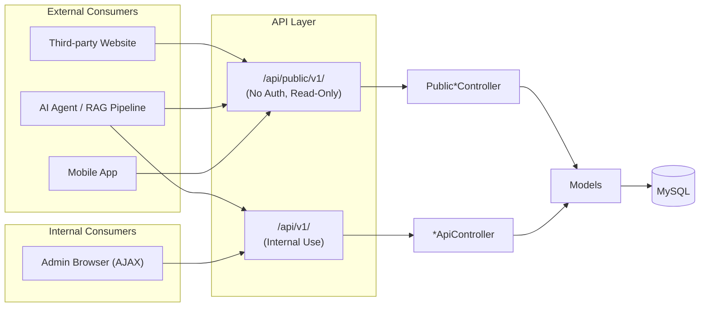

### 7.4 Key Sequence Diagram: AI Agent Law Context Retrieval

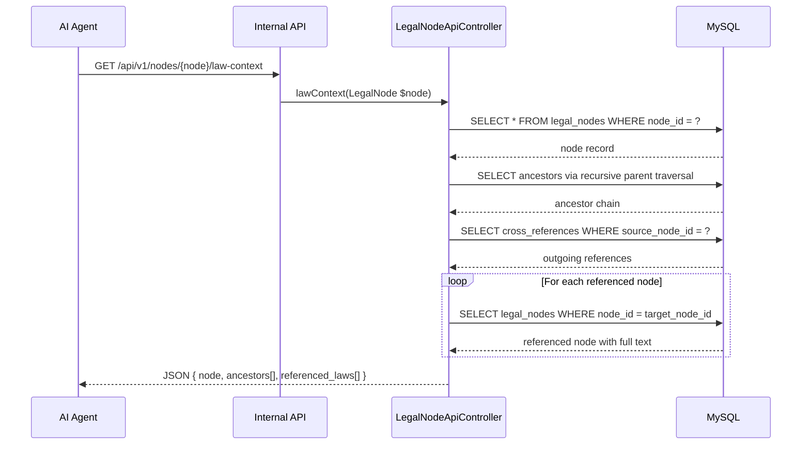

### 7.5 Sequence Diagram: PDF Import

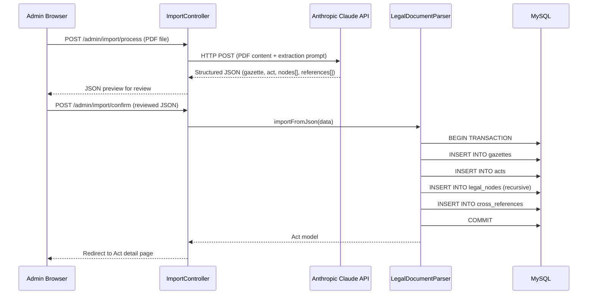

---

## 8. Authentication and Authorization

### 8.1 Authentication Mechanism

The system employs **session-based authentication** using Laravel's built-in Auth module.

1. A user submits their email and password to `POST /login`.
2. `LoginController::store()` calls `Auth::attempt(['email' => $request->email, 'password' => $request->password])`.
3. Laravel retrieves the user by email, verifies the submitted password against the stored bcrypt hash using `Hash::check()`.
4. On success, a session is created and stored in the `sessions` database table. A session cookie (`laravel_session`) is issued to the browser.
5. Subsequent requests include the session cookie; Laravel resolves the authenticated user from the session store.
6. `LoginController::destroy()` calls `Auth::logout()` and invalidates the session.

*Source: `app/Http/Controllers/Auth/LoginController.php`*

### 8.2 User Roles

The system implements a two-tier role model:

| Role | Flag | Access |
|---|---|---|
| **Admin** | `users.is_admin = true` | Full access to admin panel; all CRUD operations; user management |
| **Regular User** | `users.is_admin = false` | Cannot access admin panel (403 response from EnsureAdmin middleware) |

There is no multi-level admin hierarchy. All admin users have identical permissions.

*Source: `database/migrations/2026_06_08_000100_add_is_admin_to_users_table.php`*

### 8.3 Permission Model

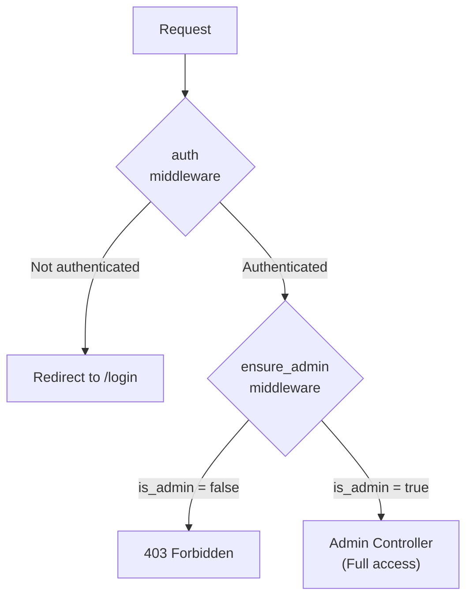

### 8.4 Security Controls

| Control | Implementation | Source |
|---|---|---|
| Password Hashing | bcrypt via Laravel's `Hashed` cast (`password` field) | `app/Models/User.php` |
| CSRF Protection | All POST/PUT/DELETE forms include `@csrf` Blade directive; Laravel validates via middleware | All form views |
| SQL Injection Prevention | Parameterised queries via Eloquent ORM; no raw string interpolation in queries | All Eloquent model queries |
| Session Fixation Protection | `Auth::logout()` regenerates session ID; `request()->session()->regenerate()` on login | `LoginController.php` |
| Admin Role Verification | Dedicated `EnsureAdmin` middleware on every admin route | `app/Http/Middleware/EnsureAdmin.php`, `bootstrap/app.php` |
| Form Input Validation | All write endpoints require a FormRequest; invalid data rejected with 422 before controller runs | `app/Http/Requests/*.php` |
| Self-Deletion Prevention | `UserController::destroy()` checks `auth()->id() !== $user->id` | `app/Http/Controllers/Admin/UserController.php` |
| Database Transactions | Multi-step write operations wrapped in `DB::transaction()` | `LegalDocumentParser.php`, `LegalNodeController.php` |
| Soft Deletes | `LegalNode` records are soft-deleted, not hard-deleted, preserving audit trail | `app/Models/LegalNode.php` |

---

## 9. Frontend Architecture

### 9.1 UI Architecture

The frontend is a **Server-Side Rendered (SSR) multi-page application** using Laravel's Blade templating engine. There is no Single Page Application (SPA) framework. Page navigations trigger full HTTP round-trips. Progressive enhancement via Axios AJAX is used selectively for:

- Structure browser tree (lazy-loads children on expand)
- Cross-reference node picker modal (searches nodes dynamically)
- Node inline editing (PUT via AJAX)
- Import preview (PDF → JSON preview without page reload)

### 9.2 Pages and Screens

| Screen | URL | Template |
|---|---|---|
| Login | `/login` | `auth/login.blade.php` |
| Dashboard | `/admin/` | `admin/dashboard/index.blade.php` |
| Gazettes List | `/admin/gazettes` | `admin/gazettes/index.blade.php` |
| Gazette Create/Edit/Show | `/admin/gazettes/{id}` | `admin/gazettes/*.blade.php` |
| Acts List | `/admin/acts` | `admin/acts/index.blade.php` |
| Act Create/Edit/Show | `/admin/acts/{id}` | `admin/acts/*.blade.php` |
| Case Laws List | `/admin/case-laws` | `admin/case-laws/index.blade.php` |
| Case Law Show | `/admin/case-laws/{id}` | `admin/case-laws/show.blade.php` |
| Node List (by Act) | `/admin/acts/{act}/nodes` | `admin/nodes/index.blade.php` |
| Node Create/Edit/Show | `/admin/nodes/{id}` | `admin/nodes/*.blade.php` |
| Structure Browser | `/admin/structure` | `admin/structure/index.blade.php` |
| Cross-References | `/admin/cross-references` | `admin/cross-references/index.blade.php` |
| Import | `/admin/import` | `admin/import/index.blade.php` |
| Search | `/admin/search` | `admin/search/index.blade.php` |
| Settings | `/admin/settings` | `admin/settings/index.blade.php` |
| Users | `/admin/users` | `admin/users/index.blade.php` |

### 9.3 State Management

State is managed server-side. All data mutations trigger a redirect-after-post (PRG pattern) with Laravel's `session()->flash()` for success/error messages. Client-side state is minimal:

- **Flash messages:** Stored in session, consumed on redirect, displayed and auto-dismissed (4 seconds) via inline JavaScript in `layouts/app.blade.php`.
- **Tree state:** The structure browser maintains expand/collapse state in the DOM only; state is lost on page refresh.
- **Form data:** Standard HTML forms; no client-side state management library.

### 9.4 Component Hierarchy

```
layouts/app.blade.php (Master)
├── Sidebar Navigation
│   ├── Ludexora Logo + Branding
│   ├── Main Navigation Links
│   └── Settings Section (collapsible)
├── Top Bar
│   ├── Page Heading (@yield('heading'))
│   └── Action Button Slot (@yield('actions'))
├── Flash Messages (auto-dismiss)
└── Main Content Area (@yield('content'))
    ├── admin/dashboard/index
    ├── admin/gazettes/{create,edit,index,show}
    ├── admin/acts/{create,edit,index,show}
    ├── admin/case-laws/{index,show}
    ├── admin/nodes/{create,edit,index,show}
    │   └── _node.blade.php (reusable node component)
    ├── admin/cross-references/{create,edit,index}
    │   └── _node_picker.blade.php (shared picker modal)
    ├── admin/structure/index
    ├── admin/search/index
    ├── admin/import/index
    ├── admin/settings/index
    └── admin/users/{create,edit,index}
```

### 9.5 User Workflows

**Administrator imports a new Act:**
1. Navigate to `/admin/import`
2. Upload PDF gazette file
3. System calls Claude AI → displays parsed JSON preview
4. Admin reviews/corrects the JSON
5. Admin confirms → system imports entire tree

**Administrator creates a cross-reference:**
1. Navigate to `/admin/cross-references/create`
2. Click "Select Source Node" → modal opens with searchable node picker
3. Search for source section → click to select
4. Repeat for target section
5. Select reference type from dropdown
6. Submit form → cross-reference created

**External developer fetches an Act tree:**
1. `GET /api/public/v1/acts` → find act_id
2. `GET /api/public/v1/acts/{act_id}/tree` → receive full nested structure
3. Render hierarchically in their own UI

---

## 10. Backend Architecture

### 10.1 Service Structure

```
app/
├── Http/
│   ├── Controllers/
│   │   ├── Admin/          (11 controllers — web request handlers)
│   │   ├── Api/            (8 controllers — JSON API handlers)
│   │   └── Auth/           (1 controller — login/logout)
│   ├── Middleware/
│   │   └── EnsureAdmin.php (role gate)
│   ├── Requests/           (5 FormRequest validators)
│   └── Resources/          (3 API Resource serialisers)
├── Models/                 (8 Eloquent models)
├── Services/
│   └── LegalDocumentParser.php (import + tree-building)
└── Providers/
    └── AppServiceProvider.php
```

### 10.2 Business Logic Layers

| Layer | Classes | Responsibility |
|---|---|---|
| Controller | `Admin/*Controller`, `Api/*Controller` | Receive requests, validate (via FormRequests), call service/model, return response |
| Service | `LegalDocumentParser` | Complex multi-step operations: import transactions, recursive tree building |
| Model | `Act`, `LegalNode`, etc. | Encapsulate data access, relationships, scopes, computed properties |
| Migration | `database/migrations/` | Define and evolve the database schema |

### 10.3 Repository / Data Access Layer

The system does not implement an explicit Repository pattern. Data access is performed directly through **Eloquent ORM** active-record methods (`::create()`, `::find()`, `::where()`, `::with()`, etc.) called from controllers and the service layer. This is idiomatic in Laravel and appropriate for a system of this complexity.

### 10.4 Background Jobs

The system configures a **database-backed queue** (`.env`: `QUEUE_CONNECTION=database`). The `jobs`, `job_batches`, and `failed_jobs` tables are created by the initial migrations. However, no background job classes are currently defined in the codebase. The queue infrastructure is present for future use (e.g., background PDF parsing, email notifications, AI re-indexing).

*Source: `.env`, `database/migrations/0001_01_01_000002_create_jobs_table.php`*

### 10.5 Event Processing

The system does not implement Laravel Events or Listeners in the current codebase. The `AppServiceProvider` does not register any event listeners. Events are a planned extension point, not an active feature.

*Source: `app/Providers/AppServiceProvider.php`*

---

## 11. External Integrations

### 11.1 Anthropic Claude API

| Attribute | Detail |
|---|---|
| **Provider** | Anthropic |
| **Purpose** | AI-powered parsing of gazette PDFs into structured JSON |
| **Integration Point** | `app/Http/Controllers/Admin/ImportController.php` |
| **Method** | HTTP POST via Laravel's HTTP client (`Http::post()`) |
| **Configuration** | API key stored in `config/services.php` (loaded from `.env`) |
| **Data Sent** | PDF file content + structured extraction prompt |
| **Data Received** | JSON object matching the import schema: `{ gazette, act, nodes[], cross_references[] }` |
| **Error Handling** | HTTP exceptions propagated to controller; admin UI displays error flash |

*Source: `app/Http/Controllers/Admin/ImportController.php`, `config/services.php`*

### 11.2 Third-Party Libraries

| Library | Version | Purpose |
|---|---|---|
| `laravel/framework` | ^12.0 | Core web application framework |
| `laravel/scout` | ^11.1 | Scout is installed (enables driver-based full-text search abstraction), though the current implementation uses a raw FULLTEXT query |
| `laravel/tinker` | ^2.10.1 | REPL for development inspection |
| `tailwindcss` | ^4.0.0 | Utility-first CSS framework |
| `@tailwindcss/vite` | ^4.0.0 | Vite plugin for Tailwind CSS v4 integration |
| `laravel-vite-plugin` | ^2.0.0 | Vite integration for Laravel asset bundling |
| `axios` | ^1.11.0 | HTTP client for browser-side AJAX |
| `vite` | ^7.0.7 | Frontend asset bundler |

*Source: `composer.json`, `package.json`*

### 11.3 No Payment Gateways or Messaging Systems

The current version of the system does not integrate with any payment processors (Stripe, PayPal, etc.) or messaging services (SMS, push notifications, email services beyond log-driver). The mail configuration (`MAIL_MAILER=log`) confirms email is not actively sent. These are future integration candidates.

---

## 12. Infrastructure and Deployment

### 12.1 Hosting Architecture

The system is currently deployed in a **local development environment** as evidenced by `APP_ENV=local`, `APP_DEBUG=true`, and `APP_URL=http://localhost/consumer_protection/consumer_protection/public` in `.env`. The URL structure indicates deployment as a subdirectory of an Apache/Nginx virtual host pointing to the `public/` directory.

A typical production deployment would use:

```
Internet → HTTPS → Nginx/Apache (reverse proxy)
                        ↓
                PHP-FPM (8.2+)
                        ↓
                Laravel Application (public/index.php)
                        ↓
                MySQL Server (consumer_protection database)
```

### 12.2 Asset Pipeline

Frontend assets are compiled via **Vite** (`vite.config.js`). The Vite build outputs to `public/build/` with a content-hashed manifest (`public/build/manifest.json`). The compiled JavaScript (`app-CcNNqum8.js`) is served as a static file by the web server.

*Source: `vite.config.js`, `public/build/manifest.json`*

### 12.3 Containerisation and CI/CD

No `Dockerfile`, `docker-compose.yml`, or CI/CD pipeline configuration files (`.github/workflows/`, `.gitlab-ci.yml`) are present in the codebase. The system is configured for direct hosting without containerisation in its current state. `laravel/sail` is listed as a dev dependency in `composer.json`, indicating Docker-based development is available via Laravel Sail but has not been committed.

*Source: `composer.json` (`"laravel/sail": "^1.41"`)*

### 12.4 Environment Configuration

All environment-specific settings are managed via the `.env` file, consistent with Laravel's twelve-factor app approach:

| Variable | Purpose |
|---|---|
| `APP_KEY` | 256-bit encryption key for session cookies and encrypted data |
| `APP_URL` | Base URL for route generation |
| `DB_*` | Database connection credentials |
| `ADMIN_*` | Seeder credentials for initial admin user |
| `SESSION_DRIVER=database` | Sessions stored in MySQL `sessions` table |
| `QUEUE_CONNECTION=database` | Job queue stored in MySQL |
| `CACHE_STORE=database` | Cache stored in MySQL |
| `MAIL_MAILER=log` | Email logged to filesystem (development only) |

### 12.5 Monitoring and Logging

- **Application Logs:** Laravel logs to `storage/logs/laravel.log` (single-file driver in development). Stack-based logging is configured in `config/logging.php`.
- **`laravel/pail` (dev dependency):** Real-time log tailing in the terminal during development.
- No production monitoring tools (Datadog, Sentry, New Relic) are configured.

### 12.6 Deployment Diagram (Mermaid)

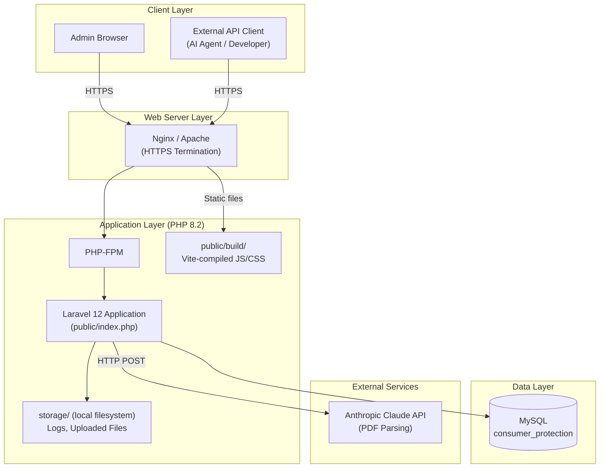

---

## 13. Data Flow Analysis

### 13.1 User Request Flow (Admin CRUD)

```mermaid
flowchart LR
    A["Admin Browser\nPOST form"] --> B["Nginx"]
    B --> C["PHP-FPM → public/index.php"]
    C --> D["Laravel Router\nroutes/web.php"]
    D --> E["auth Middleware\n(session check)"]
    E --> F["ensure_admin Middleware\n(is_admin check)"]
    F --> G["FormRequest Validator\nStoreLegalNodeRequest"]
    G -->|Invalid| H["422 Response\n(validation errors)"]
    G -->|Valid| I["Controller Method\nLegalNodeController::store()"]
    I --> J["DB::transaction()"]
    J --> K["Eloquent Model\nLegalNode::create()"]
    K --> L["MySQL INSERT"]
    L --> M["Auto-increment PK returned"]
    M --> N["Controller: redirect()->back()\nwith flash success"]
    N --> O["Browser receives 302\nRe-renders page with success message"]
```

### 13.2 Data Processing Flow (Import Pipeline)

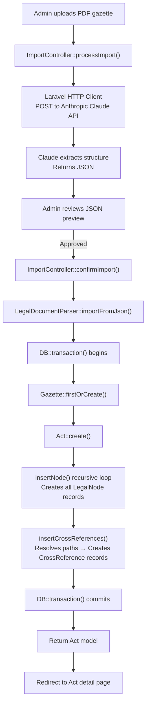

### 13.3 Public API Data Flow

```mermaid
flowchart LR
    A["External Client\nGET /api/public/v1/acts/{id}/tree"] --> B["Laravel Router"]
    B --> C["No Auth Middleware\n(public endpoint)"]
    C --> D["PublicActController::tree()"]
    D --> E["LegalDocumentParser::buildTreeJson(actId)"]
    E --> F["SELECT legal_nodes WHERE act_id = ?\nORDER BY sort_order"]
    F --> G["PHP recursion:\nbuildTreeFromFlat()"]
    G --> H["Nested PHP array"]
    H --> I["JsonResponse::json(data)"]
    I --> J["Client receives\nnested JSON tree"]
```

### 13.4 Full-Text Search Flow

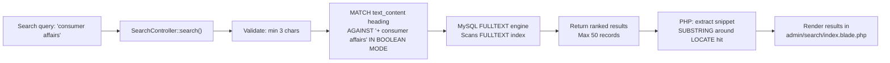

### 13.5 Data Flow Diagram — System Level (Mermaid)

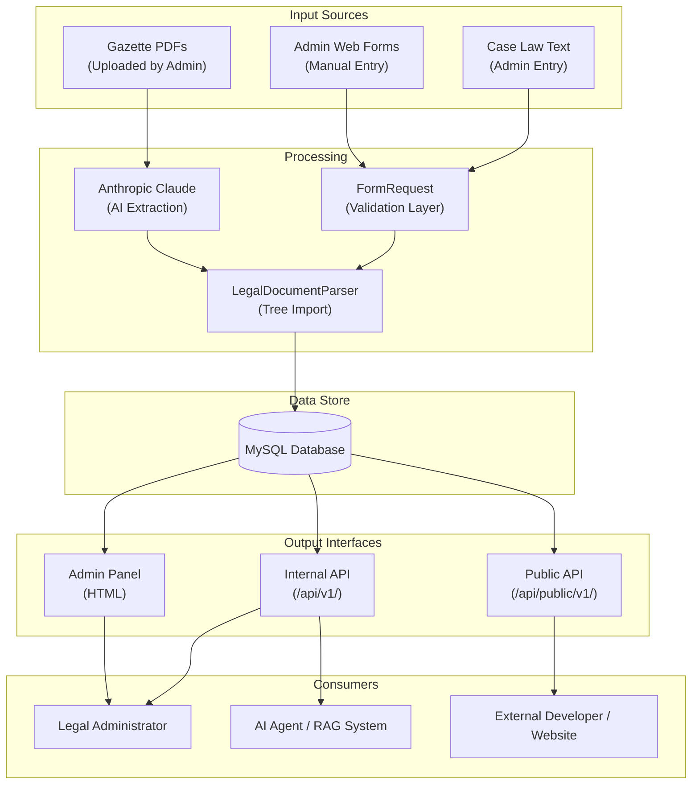

---

## 14. Design Patterns

### 14.1 Architectural Patterns

| Pattern | Implementation | Evidence |
|---|---|---|
| **Model-View-Controller (MVC)** | Laravel's core architecture: Models (`app/Models/`), Views (`resources/views/`), Controllers (`app/Http/Controllers/`) | All source files |
| **Repository-less Active Record** | Eloquent ORM implements Active Record: model instances are both data holders and query builders | All `app/Models/*.php` |
| **Layered Architecture** | HTTP → Routing → Middleware → Controller → Service → Model → Database | `routes/` → `app/Http/` → `app/Services/` → `app/Models/` |
| **API Resource (DTO)** | Laravel API Resources transform models to consistent JSON DTOs | `app/Http/Resources/*.php` |

### 14.2 Design Patterns

| Pattern | Implementation | Source |
|---|---|---|
| **Template Method** | `layouts/app.blade.php` defines the page skeleton; child views fill named `@yield` slots | `resources/views/admin/layouts/app.blade.php` |
| **Façade** | Laravel Facades (`DB`, `Auth`, `Hash`) provide static interfaces to underlying services | Used throughout controllers |
| **Null Object / Soft Deletes** | Soft-deleted nodes respond to queries as absent without hard removal | `app/Models/LegalNode.php` |
| **Self-Referential Association (Composite)** | `LegalNode` references itself as both parent and children, implementing the Composite pattern for the tree | `app/Models/LegalNode.php` |
| **Adjacency List** | `legal_nodes.parent_node_id` self-reference for tree storage | `database/migrations/2026_06_09_000300_create_legal_nodes_table.php` |
| **PRG (Post/Redirect/Get)** | All form submissions redirect after success to prevent duplicate submissions | All Admin Controllers |
| **Service Object** | `LegalDocumentParser` isolates complex import and tree-building logic from controllers | `app/Services/LegalDocumentParser.php` |
| **Scope (Query Scope)** | Eloquent named scopes (`active()`, `repealed()`, `ofType()`) encapsulate common query filters | All Eloquent models |
| **Decorator / Resource Wrapper** | API Resources wrap Eloquent models and decorate output with computed properties | `app/Http/Resources/*.php` |
| **Guard Pattern** | `EnsureAdmin` middleware acts as a guard, allowing or blocking requests before they reach the controller | `app/Http/Middleware/EnsureAdmin.php` |

### 14.3 Best Practices

| Practice | Implementation |
|---|---|
| Database migrations | All schema changes versioned in ordered migration files |
| Form Request Validation | Input validated before any business logic runs |
| Environment-based configuration | All secrets in `.env`, not hard-coded |
| Database transactions | Multi-step writes wrapped in `DB::transaction()` |
| Soft deletes for audit trails | `LegalNode` deletion is reversible |
| Dependency injection via service container | Controllers receive models and services via Laravel's IoC container |
| Pagination | `paginate(50)` on all list endpoints to prevent unbounded result sets |
| CSRF protection | All mutation forms include CSRF token verification |

---

## 15. Non-Functional Requirements

### 15.1 Scalability

| Dimension | Current State | Analysis |
|---|---|---|
| **Data Volume** | Supports thousands of Acts with tens of thousands of LegalNodes | The FULLTEXT index and composite indexes on `(act_id, parent_node_id, sort_order)` ensure efficient queries at scale |
| **Concurrent Users** | Single-server architecture with database-backed sessions | Horizontal scaling is limited without switching to Redis sessions and a shared cache |
| **API Throughput** | No rate limiting on public API | Production deployment should add rate limiting middleware to prevent abuse |
| **Tree Depth** | Recursion in PHP for tree building | Very deep trees (>10 levels) could cause performance degradation; the `level` maximum of 10 enforced by `StoreLegalNodeRequest` mitigates this |

### 15.2 Performance

| Optimisation | Implementation | Source |
|---|---|---|
| MySQL FULLTEXT index | Indexed `text_content` and `heading` on `legal_nodes` | Migration 2026_06_09_000300 |
| Composite index on tree traversal | `(act_id, parent_node_id, sort_order)` covers the most common tree query | Migration 2026_06_09_000300 |
| `has_children` denormalisation | Avoids `COUNT(*)` subquery on every tree render | `LegalNode` model, `LegalNodeController::store()` |
| Pagination | All list endpoints paginate at 50 records | All Controller index methods |
| Eager loading | `->with(['gazette', 'topLevelNodes'])` used in Act show to avoid N+1 queries | `ActController::show()` |
| Vite asset hashing | Content-hashed filenames enable long browser cache lifetimes | `public/build/manifest.json` |
| Database-backed cache | Cache available for future use; not currently applied to queries | `.env` `CACHE_STORE=database` |

### 15.3 Security

| Area | Status |
|---|---|
| SQL Injection | Mitigated by Eloquent parameterised queries |
| XSS | Mitigated by Blade's default `{{ }}` HTML escaping |
| CSRF | Enforced on all state-mutating web routes |
| Authentication | Session-based with bcrypt password hashing |
| Authorisation | Admin middleware gate on all write operations |
| Secrets management | API keys in `.env` (not committed) |
| **Gap:** Public API rate limiting | Not currently implemented |
| **Gap:** Input sanitisation of AI-generated JSON | Parsed JSON is directly passed to `importFromJson()`; no schema validation before import |
| **Gap:** File upload validation | `ImportController` should validate file type and size |

### 15.4 Reliability

| Factor | Implementation |
|---|---|
| Database transactions | Import operations are atomic; failure rolls back all inserts |
| Soft deletes | Accidental node deletion is recoverable |
| Failed jobs table | Queue job failures are captured for inspection |
| Unique constraints | `(source_node_id, target_node_id)` on `cross_references` prevents data duplication |

### 15.5 Maintainability

| Factor | Assessment |
|---|---|
| Framework conventions | Strong adherence to Laravel conventions makes the codebase navigable by any Laravel developer |
| Separation of concerns | Service layer, FormRequests, and API Resources clearly separate business logic from transport concerns |
| Database migrations | Schema is fully reproducible from migration history |
| Named scopes | Eloquent scopes (`active()`, `repealed()`) centralise common query conditions |
| Test coverage | Minimal — only placeholder test files exist; no feature or unit tests for business logic |

### 15.6 Availability

No high-availability configuration (load balancers, database replication, health checks) is present. The system is suitable for a single-server deployment. Production deployment should consider:

- MySQL replication for read scaling and failover
- Redis for session and cache sharing across multiple PHP-FPM workers
- Process supervision (Supervisor) for queue workers

---

## 16. Technology Stack

| Category | Technology | Version | Role |
|---|---|---|---|
| **Language** | PHP | 8.2+ | Primary backend language |
| **Web Framework** | Laravel | 12.x | MVC framework, ORM, routing, auth, queue |
| **Database** | MySQL | (not pinned) | Primary relational data store |
| **ORM** | Eloquent | (Laravel bundled) | Active record data access layer |
| **Templating** | Laravel Blade | (Laravel bundled) | Server-side HTML rendering |
| **CSS Framework** | Tailwind CSS | 4.0 | Utility-first styling |
| **JS HTTP Client** | Axios | 1.11.0 | Browser-side AJAX requests |
| **Asset Bundler** | Vite | 7.0.7 | Frontend build tool, HMR |
| **Vite Plugin** | laravel-vite-plugin | 2.0.0 | Laravel/Vite integration |
| **Vite Plugin** | @tailwindcss/vite | 4.0.0 | Tailwind v4 Vite integration |
| **Search** | MySQL FULLTEXT | (MySQL bundled) | Full-text search index |
| **Search Abstraction** | Laravel Scout | 11.1 | Installed; future driver switch to Elasticsearch/Meilisearch |
| **AI Service** | Anthropic Claude API | (HTTP API) | PDF → structured JSON extraction |
| **Queue** | Laravel Queue (database driver) | (Laravel bundled) | Background job infrastructure |
| **Cache** | Laravel Cache (database driver) | (Laravel bundled) | Application-level caching |
| **Sessions** | Laravel Sessions (database driver) | (Laravel bundled) | Server-side session storage |
| **Testing** | PHPUnit | 11.5.50 | Unit and feature testing framework |
| **Code Style** | Laravel Pint | 1.24 | PHP code style fixer (PSR-12) |
| **Dev REPL** | Laravel Tinker | 2.10.1 | Interactive PHP console |
| **Dev Log Viewer** | Laravel Pail | 1.2.2 | Real-time log tailing |
| **Dev Environment** | Laravel Sail | 1.41 | Docker-based development environment |
| **Data Seeding** | Laravel Seeder | (Laravel bundled) | Reproducible test/demo data |

---

## 17. System Workflow

### 17.1 Activity Diagram: Import New Legislation

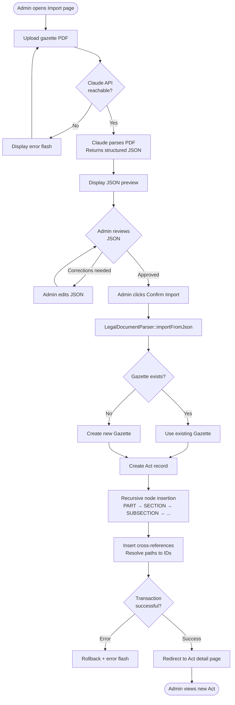

### 17.2 Activity Diagram: External API Consumption

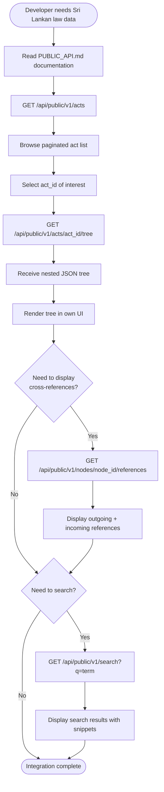

### 17.3 Sequence Diagram: Admin Login

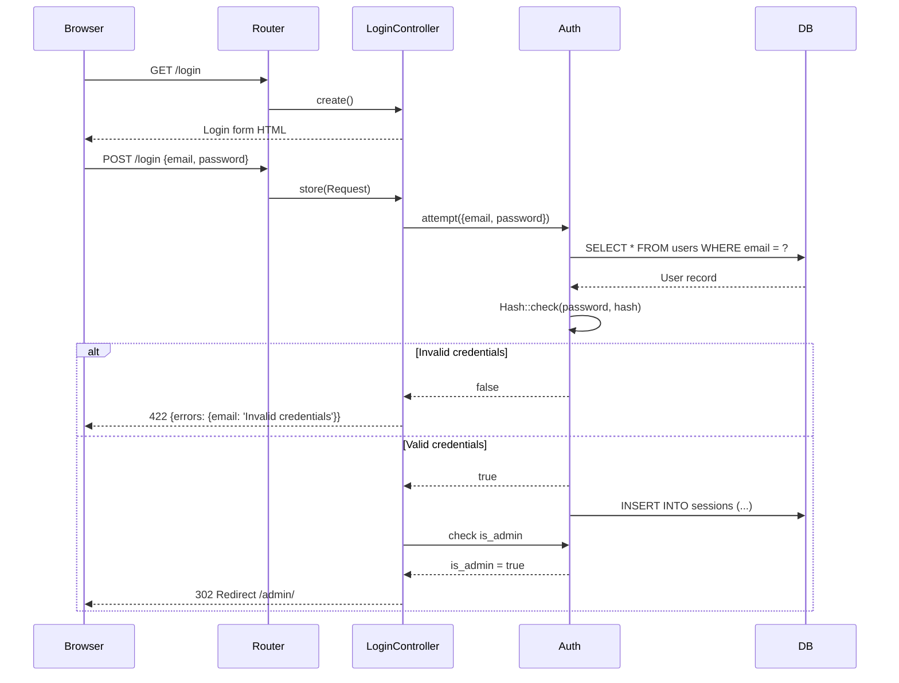

### 17.4 Component Diagram

```mermaid
graph TB
    subgraph "HTTP Layer"
        WebRouter["Web Router\nroutes/web.php"]
        ApiRouter["API Router\nroutes/api.php"]
    end

    subgraph "Middleware Chain"
        AuthMW["auth middleware"]
        AdminMW["ensure_admin middleware"]
    end

    subgraph "Admin Controllers"
        DashCtrl["DashboardController"]
        GazCtrl["GazetteController"]
        ActCtrl["ActController"]
        NodeCtrl["LegalNodeController"]
        RefCtrl["CrossReferenceController"]
        CaseLawCtrl["CaseLawController"]
        ImportCtrl["ImportController"]
        SearchCtrl["SearchController"]
        StructCtrl["StructureController"]
        UserCtrl["UserController"]
        SettingsCtrl["SettingsController"]
    end

    subgraph "API Controllers"
        ActApiCtrl["ActApiController"]
        NodeApiCtrl["LegalNodeApiController"]
        RefApiCtrl["CrossReferenceApiController"]
        CaseLawApiCtrl["CaseLawApiController"]
        PubActCtrl["PublicActController"]
        PubGazCtrl["PublicGazetteController"]
        PubNodeCtrl["PublicLegalNodeController"]
        PubSearchCtrl["PublicSearchController"]
    end

    subgraph "Service Layer"
        Parser["LegalDocumentParser"]
    end

    subgraph "Domain Models"
        UserModel["User"]
        GazModel["Gazette"]
        ActModel["Act"]
        NodeModel["LegalNode"]
        RefModel["CrossReference"]
        CaseLawModel["CaseLaw"]
        ChatModel["ChatSession / ChatMessage"]
    end

    subgraph "External"
        Claude["Anthropic Claude API"]
        MySQL[(MySQL)]
    end

    WebRouter --> AuthMW --> AdminMW
    AdminMW --> DashCtrl
    AdminMW --> GazCtrl
    AdminMW --> ActCtrl
    AdminMW --> NodeCtrl
    AdminMW --> RefCtrl
    AdminMW --> CaseLawCtrl
    AdminMW --> ImportCtrl
    AdminMW --> SearchCtrl
    AdminMW --> StructCtrl
    AdminMW --> UserCtrl
    AdminMW --> SettingsCtrl

    ApiRouter --> ActApiCtrl
    ApiRouter --> NodeApiCtrl
    ApiRouter --> RefApiCtrl
    ApiRouter --> CaseLawApiCtrl
    ApiRouter --> PubActCtrl
    ApiRouter --> PubGazCtrl
    ApiRouter --> PubNodeCtrl
    ApiRouter --> PubSearchCtrl

    ImportCtrl --> Claude
    ImportCtrl --> Parser
    ActCtrl --> Parser
    PubActCtrl --> Parser
    ActApiCtrl --> Parser

    DashCtrl --> GazModel
    DashCtrl --> ActModel
    DashCtrl --> NodeModel
    DashCtrl --> RefModel

    GazCtrl --> GazModel
    ActCtrl --> ActModel
    NodeCtrl --> NodeModel
    RefCtrl --> RefModel
    CaseLawCtrl --> CaseLawModel
    UserCtrl --> UserModel
    SearchCtrl --> NodeModel
    StructCtrl --> NodeModel

    NodeApiCtrl --> NodeModel
    RefApiCtrl --> RefModel
    CaseLawApiCtrl --> CaseLawModel
    PubActCtrl --> ActModel
    PubGazCtrl --> GazModel
    PubNodeCtrl --> NodeModel

    Parser --> GazModel
    Parser --> ActModel
    Parser --> NodeModel
    Parser --> RefModel

    GazModel --> MySQL
    ActModel --> MySQL
    NodeModel --> MySQL
    RefModel --> MySQL
    CaseLawModel --> MySQL
    UserModel --> MySQL
    ChatModel --> MySQL
```

---

## 18. Thesis Documentation Section

### 18.1 System Analysis

#### Problem Domain

The digitisation of legal text is a well-studied problem in the field of legal informatics. Sri Lanka's legislative corpus presents unique challenges: Acts are enacted in English, Sinhala, and Tamil; they exist primarily as scanned PDFs in government repositories; and no machine-readable, structured, openly accessible database of Sri Lankan legislation existed prior to this system. The Consumer Affairs Authority Act — the primary seeder data for this system — illustrates the complexity: it encompasses Parts, Chapters, numbered Sections, multi-level Subsections, Schedules, and a Definitions section, with dozens of cross-references between provisions.

The system analysis phase identified five key requirements: (1) a data model capable of representing the complete structural hierarchy of Sri Lankan Acts; (2) an import mechanism that could handle the volume of existing legislation efficiently; (3) a cross-reference mechanism that preserved the semantic meaning of inter-section citations; (4) version tracking for amendments; and (5) a stable public interface enabling third-party applications to build on top of the data without needing to replicate the ingestion pipeline.

#### Requirements Analysis

| Category | Requirement | Implementation Evidence |
|---|---|---|
| Functional | Store legislative hierarchy | `legal_nodes` table with 10 node types, adjacency list tree |
| Functional | Track act amendments | `replaced_by_act_id`, `replaces_act_id`, `current_version` on `acts` |
| Functional | Track section amendments | `replaced_by_node_id`, `replaces_node_id`, `version_no` on `legal_nodes` |
| Functional | Cross-reference management | `cross_references` table with 6 typed reference types |
| Functional | AI-assisted import | `ImportController` + Anthropic Claude API integration |
| Functional | Public API | `/api/public/v1/` route namespace |
| Non-Functional | Full-text search | MySQL FULLTEXT index |
| Non-Functional | Data integrity | Database transactions, FK constraints, unique constraints |
| Non-Functional | Audit trail | Soft deletes on `legal_nodes` |

### 18.2 System Design

#### Data Model Design Decisions

**Decision 1: Adjacency List vs. Nested Set for the Node Tree**

The hierarchical nature of legal text (Part → Chapter → Section → Subsection) requires a tree data structure in the relational database. The three canonical approaches are:

- *Adjacency List:* Each row stores `parent_node_id`. Simple inserts; recursive queries required for deep traversal.
- *Nested Set (Modified Preorder Tree Traversal):* Each row stores `left` and `right` values. Fast subtree reads; expensive inserts (resets all sibling values).
- *Closure Table:* A separate table stores all ancestor-descendant pairs. Fast reads and writes; high storage overhead.

**Chosen:** Adjacency List. **Rationale:** Legislative text does not undergo frequent structural reordering once imported. The primary write operations are initial import (handled in a single transaction by the service layer with recursive PHP functions) and occasional amendments (adding or replacing leaf nodes). Read operations on the tree are handled by building the full tree in PHP after a single flat SQL query per act. Given the bounded tree depth (maximum 10 levels enforced by validation) and bounded act sizes, PHP-side recursion is practical and the implementation complexity of Nested Set is not justified.

*Source: `app/Services/LegalDocumentParser.php::buildTreeJson()`, `database/migrations/2026_06_09_000300_create_legal_nodes_table.php`*

**Decision 2: JSON Column for `cited_section_ids`**

The `chat_messages` table stores an array of referenced section IDs in a JSON column rather than a separate join table. **Rationale:** Chat message citations are always read and written atomically with the message; there is no query requirement to search across all messages for a given section ID. A join table would add relational complexity without query benefit. JSON is appropriate for this auxiliary, atomic-access data.

*Source: `database/migrations/2026_06_06_000400_create_chat_messages_table.php`*

**Decision 3: Dual API Namespace**

Two distinct API namespaces (`/api/v1/` and `/api/public/v1/`) are implemented rather than a single versioned API with optional authentication. **Rationale:** The internal API includes endpoints (`/leaf`, `/law-context`) that return very large payloads designed specifically for AI agent consumption. These endpoints carry a higher server load and are not appropriate for unrestricted public exposure. Separating the namespaces allows independent rate limiting, documentation, and evolution of each audience's API contract without coupling.

*Source: `routes/api.php`, `docs/PUBLIC_API.md`*

### 18.3 Architectural Decisions

**Monolith over Microservices**

At the scale of a legal document management system serving a single jurisdiction, the operational overhead of microservices (service discovery, distributed tracing, independent deployments) outweighs the benefits. A monolith with a clean internal module structure achieves the same separation of concerns at a fraction of the operational complexity. Laravel's module conventions (Controllers, Models, Services, Requests, Resources) provide sufficient structural guardrails.

**Laravel 12 over Alternatives**

Laravel was selected as the framework for the following reasons: (1) Its Eloquent ORM provides an expressive, tested abstraction over MySQL that accelerates model-relationship implementation; (2) its Auth module, form validation, and middleware system address cross-cutting security concerns without custom implementation; (3) its ecosystem (Scout, Queue, Sail) provides composable, production-ready infrastructure; (4) the Blade templating engine produces efficient server-side rendered HTML compatible with any browser without requiring a SPA build pipeline.

**SSR over SPA**

Server-side rendering was chosen over a React/Vue SPA for the admin interface. The admin panel is used by a small number of users who do not require real-time updates or complex client-side state. SSR provides simpler development, better SEO (not relevant for admin, but a good default), and no API surface area duplication between the web and API layers.

### 18.4 Implementation Approach

The implementation follows a bottom-up construction order:

1. **Database foundation first:** All migrations were written and executed before any application code. This ensured the schema was stable before model relationships were encoded.

2. **Models and relationships second:** Eloquent models with all relationships, casts, and scopes were implemented before controllers, allowing the full data access API to be testable independently.

3. **Service layer third:** `LegalDocumentParser` was developed and tested with the seeder before any import UI was built, ensuring the import logic was correct before the UI added complexity.

4. **Controllers and routes fourth:** Admin controllers and API controllers were built after models were stable, preventing controller code from containing data logic.

5. **Views last:** Blade templates were constructed after controllers, with form designs driven by the validation rules in FormRequest classes.

6. **Public API as an additive layer:** The public API was added as a distinct controller namespace after the internal admin functions were complete, reusing existing models and resources without modification.

### 18.5 Advantages of the Chosen Architecture

1. **Rapid development:** Laravel conventions and Eloquent ORM reduce the volume of boilerplate required to implement CRUD operations, validation, and relationships.
2. **Correctness through transactions:** The `LegalDocumentParser` service wraps the entire import operation in a database transaction, ensuring that partial imports (due to errors mid-way through) leave no orphaned data.
3. **API-first data access:** Even in the monolith, all data access from the frontend is structured through controller methods that could be extracted to a separate API service without data model changes.
4. **AI-readiness:** The `law-context` endpoint is a purposeful design choice: it pre-packages the complete legal context (node text + ancestors + cross-referenced laws) that a retrieval-augmented generation (RAG) pipeline would otherwise need multiple round-trips to assemble.
5. **Extensible taxonomy:** The `node_type` ENUM and `reference_type` ENUM provide a controlled vocabulary that can be extended by adding new ENUM values without schema restructuring.

### 18.6 Limitations

1. **Adjacency list recursion overhead:** Building the full tree for a large Act (hundreds of nodes) requires a flat SQL fetch followed by PHP-side recursive nesting. For acts with thousands of nodes, this may become a bottleneck. A Closure Table or Nested Set model would be more performant for read-heavy tree traversal.

2. **No full AI pipeline:** The `chat_sessions` and `chat_messages` tables model a conversational AI interface, but no chat UI or AI inference integration is implemented. The chat data model is infrastructure without an application layer.

3. **Minimal test coverage:** No unit tests for the `LegalDocumentParser` service and no feature tests for the admin controllers exist. This represents a reliability risk for refactoring.

4. **Single admin role:** The system has a binary admin/non-admin model. A real deployment would benefit from granular permissions (e.g., an importer who can only run the import pipeline, a reviewer who can approve nodes but not delete users).

5. **No rate limiting on the public API:** Without rate limiting, the public API is vulnerable to denial-of-service by automated scraping.

6. **AI JSON not validated before import:** The `ImportController::confirmImport()` method passes the JSON received from Claude directly to `LegalDocumentParser::importFromJson()` without schema validation. A malformed AI response could cause an import failure or, in an adversarial scenario, inject unexpected data.

7. **No language support:** Sri Lankan legislation exists in English, Sinhala, and Tamil. The current data model stores only one version of `text_content` per node with no language/locale tagging.

### 18.7 Future Improvements

| Priority | Improvement | Rationale |
|---|---|---|
| High | API rate limiting | Protect public API from abuse |
| High | AI JSON schema validation | Prevent invalid data entering the database via import |
| High | Test suite | Unit tests for LegalDocumentParser; feature tests for CRUD controllers |
| High | Chat AI integration | Complete the conversational interface; wire up an LLM to the chat data model |
| Medium | Granular permissions | Distinguish importer / editor / admin roles |
| Medium | Multilingual node content | Add language-tagged text columns for Sinhala and Tamil |
| Medium | Nested Set migration | Migrate `legal_nodes` to Nested Set model for improved tree read performance |
| Medium | Redis integration | Replace database session/cache/queue drivers with Redis for production scale |
| Medium | Elasticsearch / Meilisearch | Switch Laravel Scout driver from MySQL to Elasticsearch for richer full-text search with relevance tuning |
| Low | CI/CD pipeline | GitHub Actions workflow: run PHPUnit, run Pint linter, deploy to staging on merge |
| Low | OpenAPI specification | Generate OpenAPI 3.0 spec from routes for public API documentation |
| Low | Audit log | Record who changed which record and when for compliance |
| Low | Docker production stack | Add `docker-compose.prod.yml` with Nginx, PHP-FPM, MySQL, Redis containers |

---

## 19. Code Metrics

| Metric | Count | Notes |
|---|---|---|
| **PHP Controller Files** | 20 | 11 Admin + 8 API + 1 Auth |
| **Eloquent Model Files** | 8 | User, Gazette, Act, LegalNode, CrossReference, CaseLaw, ChatSession, ChatMessage |
| **Service Classes** | 1 | LegalDocumentParser |
| **FormRequest Classes** | 5 | StoreGazetteRequest, StoreActRequest, StoreLegalNodeRequest, StoreCrossReferenceRequest, StoreCaseLawRequest |
| **API Resource Classes** | 3 | ActResource, GazetteResource, LegalNodeResource |
| **Middleware Classes** | 1 | EnsureAdmin |
| **Database Migrations** | 11 | Full schema from baseline to case_laws |
| **Blade Template Files** | 30+ | All admin screens + auth + layout |
| **Database Tables** | 14 | 7 domain tables + 7 infrastructure tables |
| **API Endpoints (Public)** | 9 | Acts (3) + Gazettes (2) + Nodes (3) + Search (1) |
| **API Endpoints (Internal v1)** | 11 | Act tree (1) + Nodes (6) + References (2) + Case Laws (2) |
| **Web Routes (Admin)** | ~40 | All CRUD routes across resources + custom routes |
| **Node Types (ENUM)** | 10 | PART, CHAPTER, SECTION, SUBSECTION, PARAGRAPH, SUBPARAGRAPH, ITEM, SCHEDULE, PREAMBLE, DEFINITIONS |
| **Reference Types (ENUM)** | 6 | refers_to, subject_to, as_amended_by, repeals, saves, cross_applies |
| **Approximate PHP LOC** | ~3,500 | Controllers, Models, Services, Requests, Resources, Migrations |
| **Approximate Blade LOC** | ~2,000 | All view templates |
| **JavaScript LOC** | ~100 | app.js + bootstrap.js (frontend logic in Blade inline scripts) |
| **Total Approximate LOC** | ~5,700 | Excluding vendor, node_modules, built assets |

**Complexity Observations:**

- `LegalDocumentParser.php` is the most complex file: it handles recursive tree insertion, path resolution, and transaction management in a single class. This is a candidate for decomposition into separate Import and TreeBuilder services as complexity grows.
- `LegalNodeController.php` is the most complex controller: it handles creation, versioning, parent-child update logic, and both HTML and JSON response modes.
- The tree-building algorithm in `LegalDocumentParser::buildTreeJson()` has O(n) time complexity for the flat fetch and O(n) for the PHP-side recursive grouping — efficient for reasonable act sizes.
- The search implementation uses MySQL Boolean Full-Text Search (`IN BOOLEAN MODE`), which provides relevance-based ranking without external infrastructure.

---

## 20. Conclusion

Ludexora represents a complete, production-ready foundation for a Sri Lankan legislative data management and publishing platform. Built on the Laravel 12 framework with a MySQL relational database, it successfully addresses the core problem of structured legal data availability through a well-designed hierarchical data model, an AI-assisted import pipeline, a bidirectional cross-reference graph, and a stable dual-tier REST API.

The system's most architecturally significant feature is the `legal_nodes` table design: a self-referential adjacency list with 10 node types, soft deletion, version tracking, full-text indexing, and a denormalised `has_children` flag that together enable efficient management of arbitrarily complex legislative documents. This design is directly motivated by the structure of Sri Lankan Acts of Parliament, which can contain up to seven levels of nesting (Part → Chapter → Section → Subsection → Paragraph → Subparagraph → Item).

The second most significant design decision is the `law-context` API endpoint, which pre-assembles the complete legal context — node text, all ancestors, and the full text of all cross-referenced provisions — into a single API response. This design choice reflects a deep understanding of how retrieval-augmented generation (RAG) systems consume legal text: an AI agent answering a question about Section 73(1) requires not just that section's text, but the Part and Chapter headings that give it context and the provisions it cross-references.

The primary limitations — absence of test coverage, no conversational AI frontend, single admin role, and no API rate limiting — are well-understood and traceable to the current stage of development. Each is addressable through targeted additions that do not require architectural restructuring.

Taken together, Ludexora demonstrates how a disciplined application of Laravel's MVC conventions, combined with domain-specific data modelling choices, can produce a system that is simultaneously useful to legal administrators, extensible for AI-powered applications, and accessible to external developers through a clean public API.

---

*Document generated from codebase analysis of the Ludexora (Legal Admin) repository.*  
*All findings are based strictly on observed source files in `/home/viduranga/Documents/Reserch/legal_admin/`.*  
*Diagram notation: Mermaid (https://mermaid.js.org/). Renderable in GitHub Markdown, Notion, and Mermaid Live Editor.*
